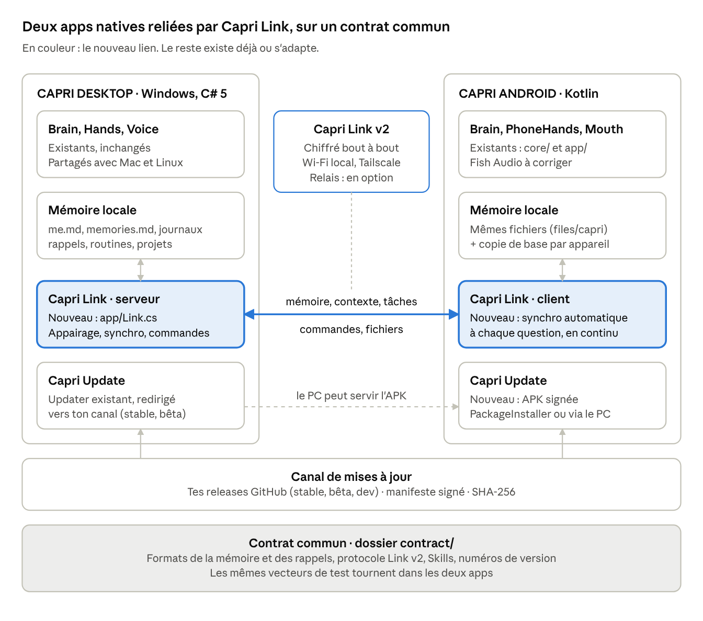
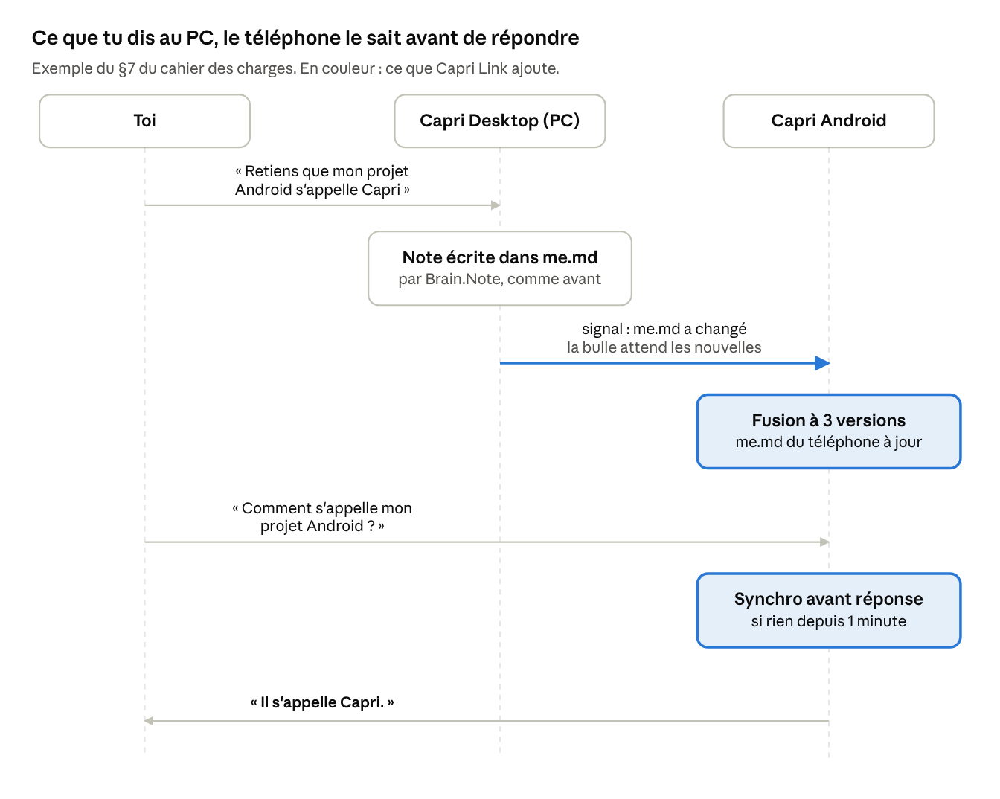
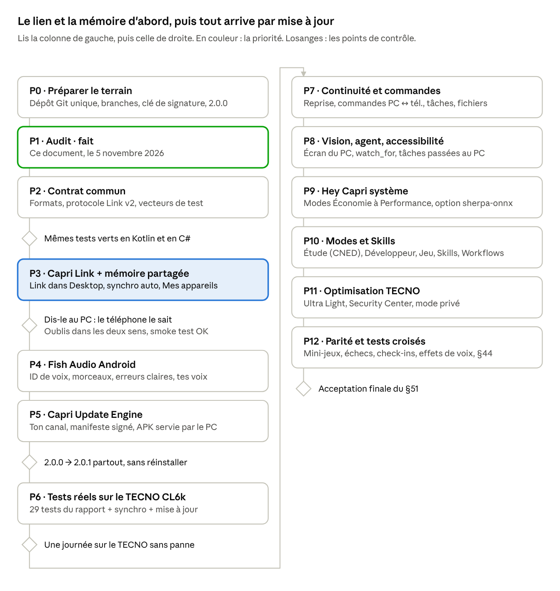

# Capri Ecosystem — Audit et plan de migration

5 novembre 2026

## En bref

Les deux projets sont solides, mais pas encore reliés : ce que tu dis à Capri sur le PC n'arrive sur le téléphone que si tu lances une synchro à la main, et un « oublie ça » revient à la synchro suivante.

- **Où on en est.** Desktop 0.8.2 : environ 111 000 lignes de C#, très complet. Android 2.0 : environ 9 500 lignes de Kotlin, du vrai code sans bouton factice. Son moteur passe 38 tests sur 38, mais l'app n'a jamais tourné sur un téléphone. Les deux ne se parlent que par CapriSync.exe, à la demande.
- **Un risque urgent.** L'updater de Desktop surveille le dépôt de l'auteur d'origine : sa prochaine version pourrait remplacer ta version modifiée.
- **Ce que je propose.** Garder deux apps natives et les relier par Capri Link, intégré à Capri Desktop. La mémoire se synchronise toute seule par une fusion à trois versions, oublis compris. Puis un Update Engine commun, puis la parité fonction par fonction.
- **Ce qui manque au cahier des charges.** Code/Husk Mode, Skills et plugins n'existent pas dans Desktop 0.8.2 : ils sont à créer.
- **Ce que j'attends de toi.** Valider les 7 décisions en bas de ce document (sans réponse, j'applique mes recommandations) et me donner ton nom d'utilisateur GitHub.

## Inventaire des deux projets

Capri Desktop est environ 11 fois plus gros que Capri Android. Android reprend le moteur (cerveau, mémoire, sécurité) mais pas les fonctions liées à Windows. La synchro est un troisième programme, séparé des deux apps.

|  | Capri Desktop 0.8.2 | Capri Android 2.0 | Capri Sync (dossier pc-sync) |
| --- | --- | --- | --- |
| Langage | C# 5, .NET Framework 4.8, WinForms + Win32 | Kotlin : core/ en JVM pur, app/ Android | C# 5, WinForms |
| Taille | app/ : 68 fichiers, 99 575 lignes (dont Capri.cs : 40 678). cross/ : 15 fichiers, 11 409 lignes | core/ : 17 fichiers, 3 941 lignes (+939 de tests). app/ : 29 fichiers, 5 514 lignes | 1 fichier, 827 lignes |
| Compilation | csc.exe de Windows via ci/build-windows.ps1, avec smoke test. Mac/Linux : .NET 10 + Avalonia (cross/) | Gradle 8.14.3, AGP 8.13.2, minSdk 30, cible 36, arm64-v8a + x86\_64 | csc.exe via build-sync.ps1 |
| Version déclarée | 0.8.2 | versionName 0.1.0, versionCode 1 (pas « 2.0 ») | 1.0 |
| Données | %LOCALAPPDATA%\\Capri : settings.json (clés DPAPI), chat.json, me.md, memories.md, transcripts/, reminders.json, routines.json, check-ins.md, games/ | files/capri/ : mêmes formats (me.md, memories.md, transcripts/) + projects/. Clés dans le Keystore Android | %LOCALAPPDATA%\\CapriSync : phones.dat (DPAPI), projects/, handoffs/, outbox/ |
| Tests | Smoke test intégré (--smoke-test), lignes PASS | 38 tests JVM du moteur + 3 tests de plugin | --selftest |
| Mises à jour | Automatiques depuis github.com/lachydotmcg/capri-desktop, le dépôt de l'auteur d'origine | Aucune | Aucune |

J'ai recompilé ici le moteur Android avec le compilateur Kotlin fourni par Gradle et relancé ses tests : **38 sur 38 réussis**. Je n'ai pas pu compiler Desktop ni l'app Android : pas de .NET ni de SDK Android dans cet environnement.

## A. Capri Desktop 0.8.2, fonction par fonction

Le cœur de Desktop (Brain.cs, Hands.cs, Voice.cs, Engine.cs) est déjà séparé de Windows : la version Mac/Linux (cross/) le compile tel quel. Tout ce qui touche l'écran, la souris, l'audio et les fenêtres est spécifique à Windows. Je n'ai rien supprimé et rien ne doit l'être.

**Absent du code 0.8.2**, alors que le cahier des charges le cite : Code/Husk Mode, Skills, plugins (les outils sont figés dans Hands.cs). « Mods » n'y désigne que les touches de raccourci (TalkMods, MuteMods). Ces fonctions sont donc à créer, pas à conserver. Si ta version modifiée les contient, envoie-la-moi.

### Cerveau, mémoire, conversation

| Fonction | Fichiers / classes | Fonctionnement et dépendances | Spécifique Windows | Réutilisation et adaptation Android |
| --- | --- | --- | --- | --- |
| Capri Brain | Brain.cs (Brain, ChatMessage), Hands.cs (Kit), FollowUps.cs | Invite = personnalité + règles + notes + souvenirs. Boucle d'outils (WorkOut, 12 tours), ou « act » + Reach pour les petits modèles. HTTP + DataContractJsonSerializer | Non (partagé avec cross/) | Déjà porté (core/Brain.kt). À ajouter : le PC et le téléphone comme destinations d'outils |
| Fournisseurs IA | Brain.cs (Cloud, KindOf), Engine.cs | Ollama, serveur OpenAI-compatible, NVIDIA (clé gratuite), Gemini, OpenRouter, OpenAI, DeepSeek, Claude. Niveaux NORMAL / MEDIUM / MAX. Cerveau intégré : llama-server.exe + Gemma 4 E4B/E2B ou Qwen3 4B | Engine.cs : oui | Porté (core/Providers.kt, Backends.kt). Pas d'IA sur le téléphone : il utilise l'Ollama du PC (mode LOCAL ou HYBRIDE) |
| Personnalité et règles | Brain.cs (DefaultPersonality, Safety), personality.md | Personnalité modifiable, règles de sécurité figées juste après | Non | Porté mot pour mot (core/Persona.kt). personality.md à synchroniser |
| Notes (mémoire explicite) | Brain.cs : Note, Unnote, Jot ; me.md ou note Obsidian | Une ligne « - fait » par note. Filtre adresses, numéros, mots de passe. 40 dernières notes dans l'invite | Non | Porté à l'identique (core/Memory.kt). **Synchro automatique à créer** |
| Souvenirs de discussion | Brain.cs : Transcribe, Fold ; transcripts/, unfolded.txt, memories.md | Chaque échange va dans le journal du jour. Le cerveau résume les lignes en attente dans memories.md | Non | Porté. **Pas synchronisé** aujourd'hui |
| Rappel des vieux moments | Brain.cs : Recalled (BM25), Moments | Retrouve les lignes de journal liées à la question, sans appel au cerveau | Non | Porté |
| Ce qu'elle a vu | Brain.cs : Saw, Seen, Sighting | 30 derniers regards sur l'écran, gardés dans chat.json | Non | Porté |
| Conversation et historique | Brain.cs (chat.json, 7 jours), Talk.cs (SpeechBox, TypeBox, TaskPanel) | 8, 16 ou 32 messages de contexte | UI : oui | Logique portée. chat.json n'a pas le même format (date ISO contre millisecondes) : à traduire |
| Rappels, minuteurs, routines | Reminders.cs ; reminders.json, routines.json | Phrases en 6 langues. Routine = « quand je dis X, fais Y » | Non | Porté, mais **format JSON différent** (Text/When contre text/due). Les routines servent de base aux Workflows |
| Aide sur elle-même | SelfKnow.cs | Répond « où est personality.md ? », « que sais-tu faire ? » | Non | À porter |

### Voix, oreilles, Hey Capri

| Fonction | Fichiers / classes | Fonctionnement et dépendances | Spécifique Windows | Réutilisation et adaptation Android |
| --- | --- | --- | --- | --- |
| Voix locales | Voice.cs (LocalVoice Kokoro, QwenVoice, ModelFile), VoicePack.cs | Kokoro-82M, Qwen3-TTS HD, fichiers Piper/Kitten/Pocket. Téléchargements épinglés par SHA-256 | Oui (exécutables) | Trop lourd pour le téléphone. Le PC peut servir de serveur de voix via Capri Link |
| Voix cloud (Fish Audio, ElevenLabs, OpenAI) | Voice.cs (Server, FishVoice, FishVoices) | Fish : POST api.fish.audio/v1/tts, clé Bearer, modèle en en-tête, reference\_id. Envoi par morceaux de quelques phrases, nouvel essai si le son est coupé, erreurs 402/404/429 expliquées, liste de tes voix | Non | Porté en partie (voir B). Morceaux, erreurs et liste des voix à reprendre |
| Effets de voix | Voice.cs (VoiceFx, Layering) | Hauteur, vitesse, robot, glitch, couches : traitement pur sur le son | Non | Portable en Kotlin. Absent sur Android |
| Oreilles | Ears.cs (Mic, LocalEars), Dictation.cs, HearingStatus.cs, MicMix.cs | Parakeet TDT 0.6B v2/v3 local via sherpa-onnx, sinon reconnaissance Windows. WASAPI | Oui | Remplacé par SpeechRecognizer. Option : sherpa-onnx existe aussi pour Android ARM64 |
| Hey Capri | Ears.cs (WakeWord) | Modèle de mot-clé sherpa-onnx (zipformer gigaspeech, 3,3 Mo), anglais | Partiel | Android a son propre moteur (MFCC + DTW sur 3 prises de ta voix). Option : le même modèle sherpa-onnx pour la parité |
| Chat vocal ElevenLabs | Agent.cs | Agent conversationnel ElevenLabs, avec ses outils | Non | Pas porté : Android enchaîne écoute, cerveau, voix |
| Mode appel Discord | CallMode.cs, CallEars.cs, CallPanel.cs, MicMix.cs, CableSetup.cs | Sa voix dans ton micro via VB-CABLE, elle entend Discord par capture audio de l'app | Oui (pilote audio) | Impossible sur Android. Proposé : piloter le mode appel du PC depuis le téléphone |
| Écoute de l'audio du PC | Hands.cs (listen), GameEars.cs | Capture du son du PC, transcription, traduction | Oui | Android 10+ : AudioPlaybackCapture avec accord, pour les apps qui le permettent. Absent |

### Mains, vision, PC

| Fonction | Fichiers / classes | Fonctionnement et dépendances | Spécifique Windows | Réutilisation et adaptation Android |
| --- | --- | --- | --- | --- |
| Vision de l'écran | Frames.cs (FrameGrab), outil look\_at\_screen, Lookout.cs (watch\_for) | Capture DXGI, image envoyée à un cerveau qui voit. watch\_for prévient quand quelque chose apparaît | Oui | Capture portée (accessibilité ou MediaProjection). watch\_for absent |
| OCR | Ocr.cs | Windows.Media.Ocr (WinRT), mots et boîtes | Oui | Remplacé par ML Kit, hors ligne |
| Clavier, souris, « fais-le » | Computer.cs (Job, HerCursor), Play.cs, Asides.cs, Bolts.cs | Tâches en plusieurs étapes avec son propre curseur. Tu peux lui parler pendant la tâche. SendInput, UI Automation | Oui | Équivalent : PhoneAgent (accessibilité). « Lui parler pendant la tâche » à porter |
| Fenêtres, apps, bureau | Hands.cs (open\_app, app\_window, list\_windows, check\_app), Arrange.cs, Ledges.cs | Ouvrir, basculer, réduire, fermer, ranger les fenêtres. Win32 | Oui | Équivalent : Intents + accessibilité (system/Phone.kt) |
| Volume par app, état du PC et d'Internet | Mixer.cs, Usage.cs, Network.cs | Mixeur Windows, processeur, mémoire, disques, ping | Oui | Android : volume média, batterie, RAM, réseau. Via Link : le téléphone peut demander l'état du PC |
| Raccourcis | Hands.cs (shortcut), GameKeys.cs | Muet Discord, capture, Game Bar, gestionnaire des tâches, loupe | Oui | Via Link : déclencher les raccourcis du PC depuis le téléphone |
| Alimentation | Hands.cs (power) | Éteindre, redémarrer, verrouiller | Oui | Via Link, toujours avec confirmation |
| Fichiers | Files.cs, FileFinder.cs | Lit txt, code, docx, xlsx, pptx, odt, PDF. Cherche sur tous les disques | Recherche : oui | Lecture portée (core/Docs.kt). Recherche sur le PC via Link |
| Web | Hands.cs (open\_website, google, youtube…), Websites.cs | Recherches DuckDuckGo, surnoms de sites | Non | Porté (core/Web.kt, avec sources). Surnoms à synchroniser |
| Musique | Hands.cs (play\_music, media), Player.cs | Spotify, YouTube, mini lecteur via la session média Windows (SMTC) | Oui (SMTC) | Porté (Music, Media, MediaSession) |

### Jeux

| Fonction | Fichiers / classes | Fonctionnement et dépendances | Spécifique Windows | Réutilisation et adaptation Android |
| --- | --- | --- | --- | --- |
| Game Sense | GameSense.cs | Repère barres de vie, flashs, bords rouges dans les images | Non (calcul pur) | Portable, mais il faut des images en continu (MediaProjection, coûteux) |
| Game Watch | GameWatch.cs | Surveille le jeu sans cerveau : son, flash, écran rouge, barre de vie | Oui (capture) | Version légère possible, sur accord, à 1 image/s. Absent |
| Game HUD | GameHud.cs | Fenêtre traversée par les clics, en haut à gauche du jeu | Oui | GamingHud Android : batterie, chaleur, RAM, heure. Partiel |
| Game Ears | GameEars.cs | Sons du jeu | Oui | AudioPlaybackCapture possible. Absent |
| Commentaires et réactions | Commentary.cs, Reactions.cs | Réagit aux moments du jeu avec le cerveau | Non (logique) | Absent : dépend de Game Watch |
| Notes de jeu | GameNotes.cs (games/jeu.md) | Ce qu'elle apprend de chaque jeu | Non | Portable et synchronisable |
| Jouer à ta place | Play.cs | Souris et clavier dans le jeu | Oui | Pas d'équivalent Android, et Capri Android refuse d'automatiser les jeux |
| Clips | Clips.cs, ClipSettings.cs | Garde les 30 dernières secondes. Media Foundation | Oui | MediaProjection + MediaCodec, ou l'enregistreur d'écran du téléphone |
| Watch Along | WatchAlong.cs | Regarder une vidéo ensemble, entendre les paroles | Oui | Possible sur accord (écran + son). Absent |
| Stream | Hands.cs (stream) | Elle joue en live et parle au chat | Oui | Sans objet sur téléphone |

### Bureau, divertissement, système

| Fonction | Fichiers / classes | Fonctionnement et dépendances | Spécifique Windows | Réutilisation et adaptation Android |
| --- | --- | --- | --- | --- |
| Compagne animée | Capri.cs (Companion), Ledges.cs, Ears.cs (BeatLock), assets/sprites | Perchée sur les fenêtres, danse sur la musique, siestes, tailles | Oui | Bulle animée avec les mêmes sprites : fait |
| Mini-jeux et échecs | Minis.cs, Chess.cs, ChessBoard.cs | Morpion, puissance 4, pierre-feuille-ciseaux, moteur d'échecs | Logique : non | Portable en Kotlin. Absent |
| Farces | Clones.cs, ChaosScreen.cs, Icons.cs, Ink.cs | Clones, faux écran bleu de 5 s, icônes, dessin à l'écran | Oui | Possible en superposition. Absent, priorité basse |
| Check-ins | Care.cs, check-ins.md | Eau, repas, pauses | Non | Portable. Absent |
| Présence Discord | Presence.cs | Rich Presence par le pipe Discord local | Oui | Impossible sur mobile. Option : le PC affiche « Capri sur mobile » |
| Notifications | Notice.cs, bulles de la zone de notification | Ses propres messages. Elle ne lit pas les notifications Windows | Oui | Android lit les notifications. Via Link : notifications entre appareils |
| Sécurité | Hands.cs (Security) | Lockdown, Guarded, Trusted, Blackwall, interrupteur par outil, oui/non | Non | Porté avec niveaux de risque (core/Tools.kt). À appliquer aux commandes à distance |
| Paramètres | Mainframe.cs (6 160 lignes), Preferences (Capri.cs), settings.json | Mainframe : cerveau, voix, toi, touches, sécurité, mémoire | Oui (UI) | SettingsActivity. Réglages communs à synchroniser |
| Mises à jour | Capri.cs (Updater, FetchLatestRelease) | API GitHub de lachydotmcg/capri-desktop, SHA256SUMS + signature, installe via Capri-Setup --update | Oui | **À rediriger vers ton canal.** Rien côté Android |
| Installateur, démarrage | Setup.cs, Startup.cs | Installation sans droits admin, clé Run de Windows | Oui | BootReceiver Android |
| Tests | SmokeRun.cs, ToolChecks.cs, ClipChecks.cs… | Smoke test : chaque ligne doit dire PASS | Oui | 38 tests JVM côté Android |

## B. Capri Android 2.0 : ce qui existe et ce qui manque

Android 2.0 est du vrai code : je n'ai trouvé ni bouton factice, ni TODO, ni fonction vide. Mais **rien n'a encore tourné sur un téléphone**. Seul le moteur est réellement testé (38/38, relancés ici). Le lien avec le PC est manuel et peut perdre des données.

Légende de l'état : **Testé** = exécuté par des tests automatiques. **Écrit** = code réel, vérifié à la compilation par la session précédente, jamais lancé sur un appareil. **Partiel** = incomplet par rapport au cahier des charges.

| Domaine | Ce qui existe | État | À corriger | À relier au Desktop |
| --- | --- | --- | --- | --- |
| Moteur : cerveau, outils, sécurité, rappels | core/Brain.kt, Tools.kt, Intents.kt, Reminders.kt, Cleanup.kt | Testé | — | Le cerveau doit savoir ce que fait l'autre appareil et pouvoir lui envoyer des outils |
| Mémoire : chat, projets, notes, souvenirs | core/Memory.kt (me.md, memories.md, transcripts/, projects/) | Testé | — | **Synchro automatique dans les deux sens** |
| Bulle, panneau, superposition | overlay/OverlayService.kt, BubbleView.kt, PanelView.kt | Écrit | — | Afficher « PC connecté » et l'état de la synchro |
| Voix : téléphone, ElevenLabs, Fish Audio, serveur OpenAI ; interruption | voice/Mouth.kt (BargeIn) | Écrit | Fish Audio : 3 défauts (tableau suivant) | Option : la voix Kokoro du PC via Link |
| Écoute et conversation continue | voice/Ears.kt | Écrit | — | Option : Whisper sur le PC via Link |
| Hey Capri | core/Wake.kt, voice/WakeListener.kt, ui/WakeTrainActivity.kt | Testé avec une voix synthétique | Fiabilité avec ta vraie voix inconnue. Option : le modèle sherpa-onnx du PC | — |
| Assistant système | assist/Assist.kt (VoiceInteractionService, RecognitionService, tuile, texte sélectionné, partage) | Écrit | — | — |
| Vision, OCR, caméra | screen/ScreenTools.kt, CapriAccessibility.kt, ML Kit, app Photo | Écrit | — | « Regarde l'écran de mon PC » via Link |
| Agent « fais-le pour moi » | screen/PhoneAgent.kt (14 étapes max) | Écrit | — | Passer une tâche au PC quand le téléphone ne peut pas |
| Contrôle d'Android | system/Phone.kt (apps, liens, musique, média, réglages, lampe, Ne pas déranger, réveils, agenda, contacts) | Écrit (phrases testées) | — | Commandes croisées PC ↔ téléphone |
| Notifications intelligentes | NotificationWatcher (Assist.kt), core/Sense.kt | Tri et résumé testés, écoute écrite | — | Notifications importantes vers le PC |
| Presse-papiers | system/Bridge.kt | Écrit (lisible seulement quand Capri a le focus, règle Android) | — | Option : presse-papiers partagé |
| Modes Étude, Dev, Jeu | core/Brain.kt (modes), Sense.kt | Partiel : ils changent les consignes du cerveau | Pas de suivi des notions, pas de plan de révision, Dev sans terminal | Mode Dev : exécuter sur le PC via Link |
| HUD de jeu | overlay/GamingHud.kt | Partiel : batterie, chaleur, RAM, heure | Pas de FPS (illisible sur Android) | — |
| Plugins | core/Tools.kt (Toolbox.register), plugins/Plugins.kt | Testé (calculatrice, tirage au sort) | Plugins en code seulement | Skills communes PC et téléphone |
| Capri Sécurité | core/Tools.kt (Risk), ui/PermissionsActivity.kt | Logique testée, écran écrit | — | Appliquer aux commandes reçues du PC |
| Réglages et clés | data/Prefs.kt (Keystore, AES-GCM) | Écrit | — | Synchroniser les réglages communs |
| Appareil et profils | system/DeviceInfo.kt ; PERFORMANCE, NORMAL, ÉCONOMIE | Écrit | 3 profils sur les 4 demandés (pas Ultra Light) | — |
| Capri Urgence | engine/PhoneHands.kt, Prefs | Écrit, désactivé par défaut | — | — |
| Capri Sync, côté téléphone | sync/SyncHub.kt, core/Sync.kt | Testé contre un faux PC | Voir le tableau suivant | À remplacer par Capri Link |
| Capri Sync, côté PC | pc-sync/CapriSync.cs | Jamais compilé | Voir le tableau suivant | À intégrer dans Capri Desktop |
| Mises à jour | Rien | Absent | — | Update Engine commun |
| Numéro de version | app/build.gradle.kts : 0.1.0, code 1 | À corriger | — | Version unique 2.x |

### Défauts trouvés dans le code Android

| Défaut | Où | Conséquence |
| --- | --- | --- |
| L'ID de voix Fish Audio est pris après le dernier « / » | voice/Mouth.kt, fetch | Un lien collé avec un « / » final ou un « ? » donne un mauvais ID. Desktop extrait les 32 caractères hexadécimaux |
| Fish Audio reçoit toute la réponse d'un coup | voice/Mouth.kt, cloud | Longue attente avant qu'elle parle. Desktop envoie quelques phrases à la fois |
| Erreurs Fish Audio peu claires | voice/Mouth.kt, check | « HTTP 402 » au lieu de « ce modèle demande du crédit, passe sur s2.1-pro-free » |
| La fusion des notes garde toutes les lignes des deux côtés | SyncMerge.notes et Merge.Notes | **Une note oubliée revient à la synchro suivante.** « Oublie ça » ne marche pas entre appareils |
| Rien ne se synchronise tout seul | SyncHub.kt | Ce que tu dis au PC n'arrive sur le téléphone que si tu lances « Synchronise ta mémoire », avec CapriSync.exe ouvert |
| memories.md n'est jamais synchronisé | SyncHub.memory | Ce qui s'est dit en conversation sur le PC reste sur le PC |
| Les lignes du téléphone arrivent dans les journaux du PC, pas dans sa file de résumé | CapriSync.cs, Transcript | Capri PC ne les résume jamais dans memories.md |
| Les projets sont rangés dans %LOCALAPPDATA%\\CapriSync | CapriSync.cs, Projects | Capri Desktop ne les lit jamais. Le plus récent écrase l'autre |
| Rappels, routines et chat.json : mêmes noms de fichiers, formats différents | core/Reminders.kt, Brain.kt contre Reminders.cs, Brain.cs | Copier un fichier tel quel casserait l'autre app |
| La conversation envoyée au PC s'affiche dans CapriSync | CapriSync.cs, TakeHandoff | Il faut la copier-coller à la main dans Capri |
| Deux programmes écrivent me.md en même temps | CapriSync.cs contre Brain.Note | Une note peut se perdre si les deux écrivent à la même seconde |
| Appairage : la clé longue voyage chiffrée par le code à 8 caractères | core/Sync.kt, CapriSync.cs (Pair) | Quelqu'un qui enregistre l'appairage sur ton Wi-Fi peut deviner le code hors ligne, en une à deux semaines de calcul sur une carte graphique, puis lire ta mémoire |

### Fonctions Desktop absentes d'Android

Voix locales et effets de voix, chat vocal ElevenLabs, écoute de l'audio, Game Sense, Game Watch, Game Ears, réactions et commentaires, notes de jeu, clips, Watch Along, mini-jeux et échecs, farces, check-ins, aide sur elle-même, surnoms de sites, watch\_for, lui parler pendant une tâche. Le mode appel Discord, la présence Discord et « jouer à ta place » n'ont pas d'équivalent possible sur Android : je propose de les piloter sur le PC depuis le téléphone.

## C. Matrice de comparaison

Sur 50 fonctions, 19 existent déjà des deux côtés (ou sous une forme équivalente) ; il manque surtout ce qui les relie. « Données » veut dire que la logique reste propre à chaque app mais que les données doivent être synchronisées.

| Fonction | Desktop | Android | Partageable | Action nécessaire |
| --- | --- | --- | --- | --- |
| Capri Brain | Oui | Oui (porté) | Oui | Ajouter les appareils et les Skills comme destinations |
| Fournisseurs IA | Oui (8 + cerveau intégré) | Oui (8) | Oui | Utiliser l'Ollama du PC via Link |
| Personnalité | Oui | Oui | Données | Synchroniser personality.md |
| Mémoire : notes (me.md) | Oui | Oui | Données | Synchro automatique, oublis compris |
| Mémoire : souvenirs et journaux | Oui | Oui | Données | Synchroniser les journaux, résumer des deux côtés |
| Mémoire projet | Non | Oui | Données | Ajouter à Desktop, synchroniser |
| Mémoire contexte | Non | Partiel (« on en était où ») | Données | Créer le contexte partagé |
| Mode privé | Partiel (mémoire coupable) | Partiel | Oui | Créer |
| Conversation et historique | Oui | Oui | Données | Reprise de conversation entre appareils |
| Rappels et routines | Oui | Oui | Données | Format commun et synchro |
| Tâches et événements | Non | Partiel (agenda) | Données | Créer des tâches partagées |
| Workflows (« Mode Cours ») | Partiel (routines) | Partiel (routines) | Oui | Étendre les routines |
| Voix cloud : Fish Audio, ElevenLabs, OpenAI | Oui | Oui | Oui | Corriger Fish Audio côté Android |
| Voix locales : Kokoro, Qwen3 | Oui | Non | Non | Servir la voix depuis le PC |
| Effets de voix | Oui | Partiel (hauteur, vitesse) | Oui | Porter VoiceFx |
| Oreilles | Oui (Parakeet) | Oui (SpeechRecognizer) | Non | — |
| Hey Capri | Oui (anglais) | Oui (ta voix) | Partiel | Tester sur le TECNO |
| Interruption | Oui | Oui | Oui | Tester sur le TECNO |
| Chat vocal ElevenLabs | Oui | Non | Oui | Plus tard |
| Vision de l'écran | Oui | Oui | Oui | « Regarde l'écran de mon PC » |
| OCR | Oui (Windows) | Oui (ML Kit) | Non | — |
| Caméra | Non | Oui | — | — |
| Clavier, souris, fenêtres | Oui | Équivalent (accessibilité) | Non | — |
| Agent « fais-le » | Oui | Oui | Partiel | Passer une tâche au PC |
| Apps, Web, musique | Oui | Oui | Oui | — |
| Fichiers | Oui | Oui (sélecteur) | Données | Transfert intégré aux deux apps |
| Notifications intelligentes | Non | Oui | Données | Notifications entre appareils |
| Presse-papiers | Partiel | Partiel | Données | Option : presse-papiers partagé |
| Appels Discord | Oui | Impossible | Non | Les piloter depuis le téléphone |
| Game Sense, Game Watch, Game Ears, réactions | Oui | Non | Logique | Version légère, sur accord |
| HUD de jeu | Oui | Partiel | Non | — |
| Clips | Oui | Non | Non | Enregistreur d'écran Android |
| Watch Along | Oui | Non | Non | Plus tard |
| Mini-jeux et échecs | Oui | Non | Logique | Porter le moteur |
| Farces | Oui | Non | Non | Priorité basse |
| Présence Discord | Oui | Impossible | — | « Capri sur mobile » via le PC |
| Study Mode | Non | Partiel | Oui | Créer : CNED, fiches, quiz, suivi des notions |
| Developer Mode, Code/Husk | Non | Partiel | Oui | Créer ; exécuter sur le PC |
| Gaming Mode | Oui | Partiel | Oui | — |
| Skills et plugins | Non | Plugins en code | Oui | Skills déclaratives communes |
| Sécurité | Oui (préréglages) | Oui (risques) | Oui | Règles pour les commandes à distance |
| Security Center | Partiel (Mainframe) | Oui | Oui | Ajouter l'état de Capri Link |
| Paramètres | Oui | Oui | Partiel | Réglages communs synchronisés |
| Capri Link | Non | Client manuel | — | Créer dans les deux apps |
| Gestion des appareils | Non | Partiel (oublier le PC) | — | Écran « Mes appareils » |
| Mises à jour | Oui (canal de l'auteur d'origine) | Non | Oui | Capri Update Engine |
| Version unique | 0.8.2 | 0.1.0 | — | Capri 2.0.0 partout |
| Offline, Hybrid, Cloud | Partiel | Oui | Oui | — |
| Resource Manager | Non | Partiel (3 profils) | Non | Ajouter Ultra Light |
| Tests | Smoke test | 38 tests | — | Tests de synchro croisés |

## Problèmes bloquants trouvés

Sept problèmes empêchent aujourd'hui « je le dis au PC, le téléphone le sait » ou mettent tes modifications en danger. Les trois premiers sont à régler avant tout le reste.

| # | Problème | Conséquence pour toi | Correction proposée |
| --- | --- | --- | --- |
| 1 | La mémoire n'est pas partagée automatiquement, et la fusion actuelle garde tout | Ce que tu dis au PC n'arrive pas seul sur le téléphone. Une note oubliée revient à la synchro suivante. memories.md et les rappels ne passent jamais | Mémoire synchronisée en continu, fusion à trois versions qui propage aussi les oublis |
| 2 | Capri Desktop ne connaît pas le téléphone | Il faut lancer et garder ouvert CapriSync.exe. Le téléphone ne peut rien demander à Capri PC (« ouvre ce projet sur mon PC ») | Capri Link intégré dans Capri Desktop, avec les mêmes verrous que Brain.Note |
| 3 | L'updater de Desktop vise le dépôt de l'auteur d'origine | Toutes les 3 heures, il vérifie github.com/lachydotmcg/capri-desktop et télécharge la nouvelle version tout seul. L'installer remplacerait ta version modifiée, Capri Link compris | Pointer l'updater vers ton propre canal avant de distribuer un Desktop modifié |
| 4 | Android ne se met pas à jour, et l'APK est signé avec une clé de debug | Une APK compilée sur un autre PC ou sur GitHub ne peut pas remplacer celle installée : Android refuse une signature différente | Créer une clé de signature unique maintenant, puis l'Update Engine |
| 5 | Les fichiers ont le même nom mais pas le même format | reminders.json, routines.json et chat.json ne peuvent pas être copiés d'une app à l'autre | Un format d'échange commun dans Capri Link ; chaque app garde ses fichiers |
| 6 | L'appairage peut être cassé hors ligne | Quelqu'un qui enregistre l'appairage sur ton Wi-Fi peut retrouver la clé et lire ta mémoire | Échange de clés ECDH + code à l'écran, avant toute connexion par Internet |
| 7 | Rien n'a tourné sur le TECNO CL6k | Les restrictions de HiOS (arrière-plan, micro, accessibilité) peuvent casser la bulle, Hey Capri ou la synchro | Phase de tests réels tôt, pas à la fin |

## Architecture cible

Je propose de garder deux apps natives et de les relier, plutôt que de forcer un code commun. Desktop reste en C# 5, Android en Kotlin. Ce qu'elles partagent est un **contrat** : mêmes formats de fichiers, même protocole, mêmes numéros de version, vérifiés par les mêmes tests des deux côtés.



Rien n'est réécrit : chaque app garde son code. Capri Link et le contrat commun font qu'une note écrite sur le PC est lue telle quelle par le téléphone.

Pourquoi pas un seul Capri.Core en C# ou en Kotlin ? Desktop est compilé par le csc.exe de Windows, sans NuGet, et 85 % de ses lignes sont dans des fichiers propres à Windows : seuls Brain, Engine, Hands, Presence et Voice sont partagés avec Mac et Linux. Un cœur commun obligerait à réécrire l'un des deux projets, ce que ton cahier des charges interdit (§46). La méthode « même algorithme, deux langages, mêmes tests » est déjà celle de Capri Sync : son chiffrement est écrit en Kotlin et en C#, et vérifié par un même vecteur de test. Le côté Kotlin passe ce test ; le côté C# reste à lancer sur ton PC.

### Ce qui change, et où

| Module | Desktop (C# 5) | Android (Kotlin) | Rôle |
| --- | --- | --- | --- |
| Capri Link | app/Link.cs, app/LinkPairing.cs | core/link/LinkClient.kt, app/link/LinkService.kt | Appairage, transport, « Mes appareils » |
| Synchro mémoire | app/LinkMemory.cs | core/link/MemorySync.kt | Fusion à trois versions, journaux, contexte |
| Commandes croisées | app/LinkCommands.cs + outil « phone » dans Hands | core/link/Remote.kt + outil « pc » dans Tools | Le Brain choisit l'appareil qui agit |
| Contexte de l'autre appareil | Brain.cs : une ligne de plus dans Remembered() | core/Brain.kt : idem | « Tu étais en train de travailler sur X sur ton PC » |
| Capri Update | Capri.cs : Updater, source changée | core/update/, app/update/ | Canal, vérification, installation |
| Skills | Lecteur de skills/\*.json | Lecteur de skills/\*.json | Consignes + outils autorisés, sans toucher au cœur |

CapriSync.exe est retiré une fois Link en place, mais gardé dans l'historique Git. Ses appairages devront être refaits : le nouveau protocole n'est pas compatible avec l'ancien, par sécurité.

### Organisation du dépôt

```
capri/
├── contract/   formats, protocole Capri Link v2, Skills, versions, vecteurs de test (JSON)
├── desktop/    capri-desktop 0.8.2 + Link*.cs + Update (C# 5)
├── android/    capri-android : core/ (Kotlin pur, + link/ et update/) et app/
├── skills/     Skills déclaratives communes, une par fichier
├── tools/      compilation, signature, publication, tests croisés
└── docs/
```

Branches Git : stable (ce qui marche chez toi), development, android, feature/\*. Les versions d'origine sont étiquetées avant le premier changement (desktop-0.8.2-origine, android-2.0-origine).

## Mémoire partagée : comment ça marchera

Chaque app garde ses propres fichiers. Capri Link les tient à jour des deux côtés, tout seul, et transmet aussi les oublis. Rien ne passe par un serveur extérieur.



Bulle éteinte, le signal n'arrive pas, mais la synchro avant la réponse rattrape le retard. PC éteint, le téléphone répond avec sa dernière copie.

### Ce qui se synchronise, et comment

| Niveau (§7) | Fichiers | Règle |
| --- | --- | --- |
| Temporaire : la conversation en cours | chat.json | Chaque appareil garde la sienne. « Continue ce que je faisais » envoie les derniers échanges à l'autre |
| Personnelle : notes | me.md, ou ta note Obsidian | Fusion à trois versions, ligne par ligne. Une ligne « - Libellé : valeur » garde la valeur la plus récente |
| Personnelle : souvenirs | memories.md | Fusion à trois versions par couple (jour, puce). Chaque phrase n'est résumée qu'une fois, par l'appareil où elle a été dite |
| Journaux | transcripts/AAAA-MM-JJ.md | Ajout seulement, lignes marquées (PC) ou (téléphone). Ils servent à « rappelle-moi ce que je faisais hier » |
| Projet | projects/nom.md | Fusion à trois versions par section. Desktop apprend à les lire |
| Contexte | link/contexte-appareil.json | Chaque appareil publie le sien : app au premier plan, projet, tâche, derniers échanges. L'autre l'ajoute aux consignes de son cerveau |
| Rappels, routines, tâches | reminders.json, routines.json, traduits dans un format commun | Élément par élément : la modification la plus récente gagne, les suppressions sont transmises |
| Personnalité, réglages communs | personality.md, langue, surnom, longueur des réponses | Le plus récent gagne. En cas de conflit, l'autre version est gardée à côté |
| Appareil | Taille de la bulle, micro, touches… | Jamais synchronisé |

### Pourquoi « à trois versions » : l'exemple de l'oubli

Chaque appareil garde la version de la dernière synchro (la base). En comparant base, PC et téléphone, Capri sait qui a ajouté et qui a supprimé.

| Ligne de me.md | Base | PC | Téléphone | Résultat |
| --- | --- | --- | --- | --- |
| Aime le café | oui | oubliée | oui | Supprimée partout : l'oubli gagne |
| Aime le thé | non | non | ajoutée | Ajoutée partout |
| Projet Android : Capri | non | ajoutée | non | Ajoutée partout |
| Préfère le soir | oui | oui | oui | Gardée |

La fusion actuelle de Capri Sync ne garde pas de base : elle aurait remis « Aime le café ».

### Quand la synchro a lieu

- Juste après chaque changement sur l'un des deux appareils, si l'autre est joignable.
- En continu tant que la bulle tourne : le téléphone garde une requête ouverte vers le PC, qui répond dès qu'un fichier change. Coupé en profil ÉCONOMIE.
- Avant de répondre, si la dernière synchro a plus d'une minute. Elle n'attend jamais plus de 1,5 s : sinon elle répond avec sa copie.
- Au démarrage, puis toutes les 15 minutes en Wi-Fi (le minimum permis par Android).
- Capri Desktop surveille aussi ses fichiers : une note modifiée à la main dans me.md ou dans Obsidian part aussi.

### Contrôle de la mémoire (§39), sur les deux appareils

| Tu dis | Ce qui se passe |
| --- | --- |
| « Qu'est-ce que tu sais sur moi ? » | Elle montre notes, souvenirs et projets. Après synchro, la même réponse sur les deux appareils |
| « Oublie ça » | La note disparaît ici, puis sur l'autre appareil, et ne revient plus |
| « N'enregistre pas cette conversation » | Mode privé : rien dans les journaux, rien de synchronisé, tout est effacé à la fin |
| « Supprime ma mémoire de ce projet » | Le fichier du projet est supprimé sur les deux appareils |
| « Oublie tout » | Un effacement daté part vers l'autre appareil : tout ce qui est plus ancien disparaît des deux côtés. Toujours confirmé |

Limite à connaître : si le PC est éteint avant que le téléphone ait synchronisé, le téléphone ne peut pas savoir ce que tu as dit au PC. Le relais chiffré en option (section suivante) règle ce cas.

## Capri Link : appairage, transport, commandes

Capri Link v2 garde ce qui marche dans Capri Sync (un chiffrement écrit à l'identique dans les deux langages, réseau local) et corrige l'appairage. Il vit dans Capri Desktop : plus de programme à lancer à part.

### Appairage

1. Sur le PC : Mainframe > LINK > Ajouter un appareil. Un code de 8 caractères s'affiche, valable 5 minutes et 5 essais.
2. Sur le téléphone : Réglages > CAPRI LINK. Le PC est trouvé tout seul sur le Wi-Fi (annonce UDP sur le réseau local), sinon tu tapes son adresse. Tu tapes le code.
3. Les deux appareils échangent des clés ECDH P-256, mélangent le résultat avec le code et en tirent une clé à long terme. Le code ne voyage jamais : enregistrer l'échange ne permet plus de retrouver la clé.
4. La clé est gardée chiffrée : DPAPI sur le PC (comme tes clés API aujourd'hui), Keystore Android sur le téléphone.

Tout existe dans .NET Framework 4.8 et Android sans bibliothèque à ajouter : ECDH (ECDiffieHellmanCng, KeyAgreement), AES-256-CBC + HMAC-SHA256 comme aujourd'hui.

### Transport

| Chemin | Quand | Coût | Sécurité |
| --- | --- | --- | --- |
| Wi-Fi local (par défaut) | PC et téléphone sur le même réseau | Gratuit | Messages chiffrés et signés, toute adresse publique refusée |
| Tailscale (option conseillée) | Hors de chez toi, PC allumé | Gratuit pour un usage personnel non commercial ([Tailscale](https://tailscale.com/plans/)) | Réseau privé chiffré. Ses adresses (100.64.x.x) sont déjà acceptées par le code actuel des deux côtés |
| Relais chiffré (option, plus tard) | PC éteint, ou aucun chemin direct | Gratuit dans les limites de Cloudflare : 100 000 requêtes et 1 000 écritures KV par jour ([limites Workers](https://developers.cloudflare.com/workers/platform/limits), [limites KV](https://developers.cloudflare.com/kv/platform/limits)) | Le relais ne voit que des paquets chiffrés. Tu le déploies toi-même avec ton compte |

### Ce que Link transporte

| Opération | Sens | Exemple |
| --- | --- | --- |
| hello, pair, ping | Les deux | Appairage, « PC connecté » dans la bulle |
| sync.wait | Téléphone vers PC | Requête ouverte, réveillée dès qu'un fichier change |
| sync.pull, sync.push | Les deux | Notes, souvenirs, journaux, projets, rappels, contexte |
| handoff | Les deux | « Je vais continuer sur mon téléphone » |
| cmd | Les deux | « Ouvre ce projet sur mon PC », « Envoie ça sur mon téléphone » |
| file.put, file.get | Les deux | Fichiers par morceaux, avec reprise |
| notify | Les deux | Une notification importante du téléphone affichée sur le PC |
| update.get | Téléphone vers PC | Télécharger la nouvelle APK depuis le PC, sans données mobiles |

### Commandes à distance et sécurité

- Le Brain reçoit un outil de plus : « pc » sur le téléphone, « phone » sur le PC. C'est lui qui choisit l'appareil qui agit.
- Chaque commande garde son niveau de risque. Risque élevé (éteindre le PC, envoyer, supprimer, payer) : « Capri veut effectuer cette action. Annuler / Autoriser » sur l'appareil qui demande, quel que soit le préréglage.
- L'appareil qui exécute applique aussi son propre préréglage SÉCURITÉ, plafonné à Guarded pour ce qui vient d'ailleurs. Blackwall ne s'applique jamais à distance.
- Liste fermée : seules les commandes prévues passent (apps, projets, sites, média, raccourcis, état du PC, verrouiller, fichiers). Pas de terminal à distance sans ton accord, commande par commande.
- « Mes appareils » dans les deux apps : renommer, autoriser, révoquer, déconnecter, voir la dernière connexion. Révoquer efface la clé des deux côtés.

## Capri Update Engine et version unique

Une seule version « Capri X.Y.Z » pour les deux apps, un canal à toi, et une mise à jour déclenchée par « Mets-toi à jour ». Desktop a déjà un très bon updater : il suffit de changer sa source. Android part de zéro.

### Version unique

- Capri 2.0.0 = Desktop 2.0.0 + Android 2.0.0 + contrat 2.0.0. Sur Android, versionCode = X × 10 000 + Y × 100 + Z (2.1.0 donne 20100), car Android exige un numéro qui monte toujours.
- Partir de 2.0.0 sépare ta lignée de celle de l'auteur d'origine (0.8.x) : l'updater ne pourra plus les confondre.
- Un seul dépôt Git. Les nouveautés de l'auteur d'origine peuvent y être fusionnées à la main, quand tu le décides.

### Le manifeste : un fichier signé par canal

```json
{
  "capri": "2.1.0",
  "channel": "stable",
  "notes": ["Mémoire partagée PC ↔ téléphone", "Fish Audio corrigé"],
  "desktop": { "version": "2.1.0", "url": "…/Capri-Setup-2.1.0.exe", "size": …, "sha256": "…" },
  "android": { "version": "2.1.0", "code": 20100, "url": "…/Capri-2.1.0.apk", "size": …, "sha256": "…", "cert": "…" },
  "parts": { "skills": "…", "voices": "…" },
  "signature": "ECDSA P-256"
}
```

Il est publié dans les releases de ton propre dépôt GitHub (gratuit). Il est signé par une clé qui ne quitte jamais ton PC, et les deux apps contiennent la clé publique. Même avec ton compte GitHub piraté, une fausse mise à jour serait refusée.

### Les 10 étapes du §34, appareil par appareil

| Étape | Desktop | Android |
| --- | --- | --- |
| 1. Vérifier la version | Ton dépôt, toutes les 3 h comme aujourd'hui | Au démarrage, puis une fois par jour |
| 2. Métadonnées | Manifeste signé | Manifeste signé |
| 3. Télécharger | En arrière-plan, avec reprise (à ajouter) | En arrière-plan, avec reprise, ou depuis le PC via Link |
| 4. Intégrité | SHA-256 (existe déjà) | SHA-256 |
| 5. Signature | Signature du manifeste. Authenticode si tu signes un jour tes .exe : le code le vérifie déjà | Signature du manifeste + certificat de l'APK identique à celui installé |
| 6. Sauvegarder la config | Copie de settings.json, me.md, memories.md, journaux | Copie de files/capri |
| 7. Installer | Capri-Setup --update (existe déjà) | PackageInstaller. Depuis Android 12, une app qui se met à jour elle-même peut le faire sans question, une fois l'installation d'applis autorisée ([source AOSP](https://android.googlesource.com/platform/frameworks/base/+/c17bbf82ce4b%5E%21/)). À vérifier sous HiOS |
| 8. Redémarrer | Existe déjà | Android relance l'app |
| 9. Vérifier | La nouvelle version annonce son numéro, sinon retour arrière | Idem, avec un compte rendu au PC via Link |
| 10. Gérer l'échec | Le Capri.exe précédent est gardé et remis | Pas de retour arrière sans désinstaller : Android refuse un numéro plus petit. On republie l'ancienne version avec un numéro plus grand |

Canaux stable, bêta et dev. Le fichier téléchargé garde l'extension .partial jusqu'à sa vérification, comme Desktop le fait déjà : un téléchargement coupé ne peut pas s'installer.

### Mises à jour partielles (§36)

- Skills, personnalité par défaut, voix, modèles et configuration se téléchargent à part, sans réinstaller l'app.
- Le code ne change que par une version complète. Télécharger du code à côté de l'app serait une faille de sécurité.

### Permissions Android ajoutées

REQUEST\_INSTALL\_PACKAGES et UPDATE\_PACKAGES\_WITHOUT\_USER\_ACTION, utilisées seulement pour installer Capri elle-même. Si tu les refuses, tu installes l'APK à la main comme aujourd'hui.

### À préparer une seule fois

- [ ] Une clé de signature Android, sauvegardée en deux endroits. Sans elle, plus aucune mise à jour possible
- [ ] Un dépôt GitHub à toi pour publier les versions
- [ ] La clé de signature du manifeste, sur ton PC

## Plan de migration

Je propose de changer l'ordre du §50 sur trois points : le lien et la mémoire d'abord (ta priorité), l'Update Engine juste après, et les tests sur le TECNO tôt plutôt qu'à la fin.



Une phase ne démarre que si le point de contrôle d'avant est franchi. À partir de P5, chaque phase t'arrive par une mise à jour, sans réinstaller.

### Pourquoi cet ordre

- **P3 avant tout** : c'est ta première demande, et les problèmes 1 et 2 bloquent le reste de l'écosystème.
- **P5 juste après** : chaque phase suivante arrive par une mise à jour, et l'updater de Desktop ne peut plus écraser ta version.
- **P6 tôt** : un souci avec HiOS trouvé en P6 coûte moins cher qu'en P12.
- **La parité maximale est répartie** : chaque fonction arrive avec son thème (vision en P8, modes en P10, le reste en P12).

### Correspondance avec le §50

| Phase du cahier des charges | Phase du plan |
| --- | --- |
| 1. Audit | P1 |
| 2. Architecture commune | P2, et ce document |
| 3. Parité fonctionnelle maximale | P7, P8, P10, P12 |
| 4. Fish Audio Android | P4 |
| 5. Capri Link | P3 |
| 6. Mémoire partagée | P3 |
| 7. Vision, Agent, Accessibility | P8 |
| 8. Hey Capri, VoiceInteractionService | P9 |
| 9. Study, Developer, Gaming, Skills | P10 |
| 10. Capri Update Engine | P5 |
| 11. Optimisation TECNO CL6k | P11 |
| 12. Tests réels PC ↔ téléphone | P6, puis P12 |

### Règles pendant toute la migration (§46, §48)

- Desktop reste utilisable à chaque étape : chaque changement passe son smoke test sous Windows avant d'entrer dans la branche stable.
- Aucun fichier existant n'est supprimé. Le nouveau code va dans de nouveaux fichiers (Link.cs…), avec des retouches minimes dans Capri.cs, Brain.cs et Hands.cs.
- Tes données actuelles dans %LOCALAPPDATA%\\Capri gardent leur format : la synchro écrit les mêmes fichiers.
- Chaque phase se termine par un changelog, des tests, et une version bêta avant la version stable.

## Limites de cet environnement et tests à faire chez toi

Je peux écrire et tester ici le moteur Kotlin, mais pas compiler Desktop ni produire l'APK. Ces deux étapes se feront sur ton PC ou sur GitHub, à chaque phase.

| Ici, je peux | Chez toi (ou sur GitHub) |
| --- | --- |
| Compiler et tester le moteur Kotlin, dont la nouvelle synchro, avec de vrais tests (fait aujourd'hui : 38/38) | Compiler Capri Desktop : ci/build-windows.ps1 -SmokeTest sous Windows. Il n'y a pas de compilateur C# ici |
| Écrire le C# 5 de Desktop en suivant ses règles (pas de $"…", ni ?., ni nameof) et ajouter ses smoke checks | Produire l'APK : Android Studio, ou le workflow GitHub Actions déjà présent dans le projet |
| Simuler un PC et un téléphone qui se synchronisent : deux moteurs et un faux serveur | Tout ce qui touche le TECNO : bulle, micro, Hey Capri, accessibilité, restrictions HiOS |
| — | Fish Audio avec ta vraie clé : cet environnement ne peut pas appeler son API |

Une licence à garder en tête : Capri est sous PolyForm Noncommercial 1.0.0. Usage personnel ou non commercial seulement, avec les mentions obligatoires dans les deux apps. Vendre Capri ou la mettre dans un produit payant demande l'accord de son auteur. Le plan gratuit de Tailscale est lui aussi réservé à un usage non commercial.

### Tests croisés à cocher (§44, §51)

Ces tests s'ajoutent aux 29 de docs/TEST\_REPORT.md, à faire sur le TECNO et ton PC à la fin des phases concernées.

- [ ] Mémoire, PC vers téléphone : « Retiens que mon projet Android s'appelle Capri » sur le PC, puis la question sur le téléphone
- [ ] Mémoire, téléphone vers PC : une note sur le téléphone, retrouvée sur le PC
- [ ] Oubli dans les deux sens : « oublie ça » d'un côté, la note ne revient jamais de l'autre
- [ ] Conversation : « Je vais continuer sur mon téléphone », puis « Continue ce que je faisais »
- [ ] Contexte : « Tu étais en train de travailler sur X sur ton PC »
- [ ] Tâche : un rappel créé sur le téléphone apparaît sur le PC, et inversement
- [ ] Fichier : du téléphone vers le PC et du PC vers le téléphone
- [ ] Commande : « Ouvre mon projet sur le PC » depuis le téléphone, avec confirmation si c'est sensible
- [ ] Mise à jour : ancienne version, téléchargement, installation, redémarrage, vérification, sur les deux appareils
- [ ] Coupures : Wi-Fi coupé pendant une synchro, PC éteint, téléphone redémarré

## Décisions à valider avant de coder

Sept choix t'appartiennent. J'ai mis ma recommandation pour chacun ; sans réponse, c'est elle que j'appliquerai.

| # | Décision | Ma recommandation | Autre choix |
| --- | --- | --- | --- |
| 1 | Où vit Capri Link côté PC | Dans Capri Desktop (un seul programme, mêmes verrous que la mémoire) | Garder CapriSync.exe à part, amélioré |
| 2 | Jusqu'où va le réseau | Wi-Fi local + Tailscale ; relais chiffré plus tard si besoin | Wi-Fi local seulement |
| 3 | Clés API (Fish Audio, NVIDIA…) partagées entre appareils | Non : tu les tapes une fois sur chaque appareil | Oui, chiffrées dans Capri Link |
| 4 | Où sonne un rappel | Sur l'appareil où tu l'as créé, visible sur les deux, sauf si tu dis « sur mon téléphone » ou « partout » | Partout |
| 5 | Ordre des phases | Celui de ce plan : Link et mémoire d'abord | L'ordre exact du §50 |
| 6 | Canal de mises à jour | Un dépôt GitHub à toi pour les versions. Il me faut ton nom d'utilisateur GitHub | Mises à jour seulement depuis le PC, sans Internet |
| 7 | Code/Husk Mode, Skills, plugins | Les créer en P10 d'après le cahier des charges | M'envoyer ta version modifiée si elle les contient déjà |

### Dès ton feu vert

1. P0 : le dépôt unique avec l'historique Git, les versions d'origine étiquetées, la version 2.0.0 partout. Tu crées la clé de signature sur ton PC avec une seule commande, que je te donnerai.
2. P2 : le dossier contract/ et ses vecteurs de test.
3. P3 : le moteur de synchro en Kotlin, testé ici contre un faux PC, puis Link.cs et la synchro dans Capri Desktop, avec ses smoke checks. Tu compiles, tu appaires, tu testes « dis-le au PC, le téléphone le sait ».

## Sources

Le code des deux archives fournies (capri-desktop-0.8.2, CapriAndroid-2.0) et leurs documents, lus le 5 novembre 2026. Pages consultées pour les services externes :

- [Tailscale, plans et plan Personal](https://tailscale.com/plans/)
- [Cloudflare Workers, limites du plan gratuit](https://developers.cloudflare.com/workers/platform/limits)
- [Cloudflare Workers KV, limites](https://developers.cloudflare.com/kv/platform/limits)
- [AOSP, mises à jour sans action de l'utilisateur (PackageInstaller)](https://android.googlesource.com/platform/frameworks/base/+/c17bbf82ce4b%5E%21/)
